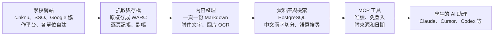

# 設計概觀

這份文件說明 nknu-mcp 整體怎麼設計：從學校網站抓資料、整理、存進資料庫，到透過 MCP 回答 AI 助理。講的是做法和理由，不是程式細節。狀態寫到 2026-10-26；標「規劃中」或「實作中」的都還沒完成，細節可能再改。各階段要抓的網站和理由見 [README 的表格](README.md#各階段打算抓的網站和理由)。

## 1. 整體架構

**三層。** 抓取與存檔層把學校網頁原樣存下、逐頁記帳；內容整理層把每一頁變成一份 Markdown（帶簡單標記的純文字格式）、建索引；MCP 工具層對外提供查詢。抓取層和整理層之間只交換固定幾樣東西：原始存檔、抓取紀錄、連結表、列表行（列表頁上每一條的標題、日期和連結）。整理規則改了，可以直接從存檔重算，不必再對學校網站發請求。

**按平台寫規則。** 學校網站看起來有幾百個，其實大多跑在少數幾套「平台」上（同一套程式建出來的一群網站）；c.nknu 和 SSO 是學校自己的兩套網站系統。官方單位網站 116 個裡：

| 平台 | 累計網站數 | 累計占比 |
|---|---|---|
| c.nknu、SSO 兩套學校平台 | 59 | 51% |
| 再加 Google 協作平台 | 82 | 71% |
| 再加 WordPress、Wix、Joomla、GitHub | 90 | 78% |

這組數字是粗估，第一輪爬完後重算。

所以每套平台寫一次規則（平台檔案），而不是每個網站寫一支程式；剩下的長尾網站交給通用規則處理（備援）。

**先抓、後整理。** 一輪一輪抓，抓完、對帳通過才開始整理層。

**和 v1 的關係。** v1 是 5 個來源的小型版本：SQLite（單檔的小型資料庫）事實庫 → 事先算好的答案卡 → 4 個 MCP 工具，已經能在本機跑。v2 保留 v1 處理「會過期的事實」（場館時段、閉館、行事曆）的做法和這 5 個來源；整理層每一步過了自己的門檻，就替換 v1 對應的部分。

## 2. 抓取與存檔（實作中：第一階段初版已寫，其餘未寫，尚未開跑）

### 2.1 一輪一輪來、三種方法

先認網頁的「種類」，再選方法。種類指同一個網站裡網址長得一樣、用同一個模板的網頁，例如某處室每一則公告的頁面。三種方法：

1. **老方法**：直接對網址發普通請求抓網頁。
2. **讀資料網址**：先找到網頁背後放資料的網址，直接讀。
3. **瀏覽器**：用瀏覽器打開，存下顯示出來的內容。

老方法也包括幾樣不用開瀏覽器的做法：ASP.NET 網站（微軟的一種網站框架）的「下一頁」「下載」「詳情」按鈕，把網頁裡藏著的表單狀態送回去就能按；Google 雲端硬碟和日曆用官方 API 讀；短網址問一次跳去哪裡；Google 表單頁讀一次、絕不送出。

第一輪只用老方法，要 JavaScript 的放第二輪。第一輪也會用瀏覽器，但只用來檢查、不靠它抓任何東西：抓完後判定網頁種類，每批對帳時打開真的網站抽查。

### 2.2 第一輪範圍

- **107 個網站**：全校學生都用得到的 34 個、對某個系所／學院／學程的學生重要的 73 個；按平台分 c.nknu 25、SSO 62、Google 協作平台 7、各單位自建 13。名單見[附錄](#附錄第一輪-107-個網站)。
- 另加 4 個不在這 107 個網站裡的公開頁面（招生報名首頁、課務查詢首頁等）。頁面用到的附件、正文圖片、雲端硬碟檔案、內嵌頁、嵌入的 6 個 Google 日曆都跟著頁面抓（放在別的主機上也抓）；第一輪網頁上直接連到的校外附件約 60 個也抓。
- 最初估計約 3 萬個網址：網頁和附件約 2.2 萬，加上正文圖片、按鈕後面的內容、雲端硬碟檔案。10-26 的核對認為 c.nknu 那台伺服器上的量可能被低估（舊清單只碰到它的 25 個網站裡的 5 個），實際數字試跑後再定。
- **起點不能比上一次少。** 10-24 第一次抓取的舊清單，按新規則重判後全部當起點；再加 Common Crawl（一個公開的網頁存檔計畫，會公開它抓過的網址索引）的網址索引和各站的網站地圖。Common Crawl 只拿網址清單，內容照樣到學校網站抓。屬於第一輪網站的：舊清單約 2 萬個、Common Crawl 新增約 8 千個。

**JavaScript 實測（10-25）。** 第一輪網站一共 1,093 種網頁，每種用瀏覽器抽一頁，和直接抓的結果比對：

| 結果 | 種類數 | 第一輪怎麼處理 |
|---|---|---|
| 直接抓就行 | 992（其中 12 種要照規則按分頁籤、下載按鈕） | 老方法 |
| 內容在框架（frame，網頁裡嵌的另一個網頁）裡 | 10 | 跟著框架頁抓 |
| 真的要 JavaScript | 4（舊存檔共 6 頁） | 照樣存下、標「下一輪」，不算完整 |
| 沒測出結論 | 87 | 標「待判定」，第一輪結束後統一用瀏覽器測，測完前不算完整 |

抓的過程中出現沒測過的新種類，一律先記「待判定」。

**「點了才載入」掃描（10-25，不連網，掃舊存檔）。** 有些內容要點分頁籤、下載按鈕才去拿，直接抓和用瀏覽器打開都看不到。掃描命中 20 種網頁、32 頁，只在國際處和電子系兩個網站（只掃了舊存檔裡有網頁的 46 個網站；其餘網站等新一輪存檔再掃一次）；其中 14 種、20 頁有原始網頁裡看不到的內容（國際處的分頁籤；電子系課程和下載頁的 85 個下載按鈕、53 個不同的檔案）。位址就寫在網頁裡、看得懂的，第一輪照規則按；看不懂的記「缺幾個頁籤或按鈕」、不算完整，第二輪用瀏覽器自動點。

### 2.3 為什麼重抓：第一次抓取的教訓

10-24 第一次原始抓取共約 5 萬個網址（50,586）：抓完 15,925、待抓 10,767、失敗 1,224、按規則跳過 22,670，原始存檔約 4.7 GB。現在第一輪的 107 個網站（加 SSO 附件下載介面按網站算 108 個）裡，舊存檔只有 46 個有網頁，其餘 62 個是 10-24 停下時還沒輪到，不是被漏掉。10-25 盤點發現的設計漏洞是：

- 圖片沒下載；
- ASP.NET 按鈕一個都沒按（36 個網站、535 種按鈕）；
- 4 種寫在網頁屬性裡的位址沒讀：Google 協作平台的「嵌入程式碼」區塊（第一輪網站 10 塊、約 8,200 字）、協作平台裡嵌入的雲端硬碟檔案（例如學生輔導中心 6 頁 30 個檔案）、圖書館首頁輪播圖的目標網址、電機系最新消息寫在背景圖網址裡的附件；
- 當時的規則還排除了榮譽、名單類網頁和部分其實不用登入的頁面。

v1 的 MCP 也讀不到這些存檔，25 題只答好 4 題（見第 6 節）。所以改成全新重抓，第一輪補上這 4 種寫法，並把「怎麼知道抓完整了」當成設計重點。

### 2.4 怎麼確保「不會以為抓完整了，其實漏了」

**證據和判定分開。** 爬蟲只記下發生了什麼：回應碼、跳到哪裡、這一頁用了哪些資源、按鈕按了沒有。「抓到了沒有」「這頁完不完整」由一處統一的規則現算；儀表板、報告、驗收都看同一份結果，不會出現兩套說法。

**每頁記帳。** 每一頁用到的附件、圖片、按鈕、下一頁、雲端硬碟檔案，每一樣都要有結果：抓到、沒抓到、為什麼。待判定的、要 JavaScript 的、缺東西的都不算完整。完整度至少分：完整、缺圖片、缺附件、要 JavaScript（留到下一輪）、出錯待重試。給人看的時候分九類：抓到了；還在排隊或等重試；連線失敗（每個寫原因）；要人看；要登入；學校那邊已經不存在；待判定；下一輪；規則不抓。

**對帳。** 不只信爬蟲自己的紀錄，也拿外部資料對：網站選單的每一項、列表上寫的總數（「共 N 筆」）、Common Crawl 的網址清單、10-24 的舊存檔、25 道測試題的答案頁、用瀏覽器打開真的網站抽查、「點了才載入」掃描。對不上的逐項列出。

**估還漏多少。** 用 Common Crawl 算「發現覆蓋率」：它記得、這一輪也抓到的網址裡，有幾成是這一輪的網頁自己連到的。再用重捕法（Lincoln–Petersen，生態學上用兩次獨立抽樣的重疊比例估族群總數的方法）估「至少還漏了約多少個」。這個數寫明是下限，只提醒、不擋「抓完」。

**驗收。** 網站要通過全部檢查，才在儀表板上標「抓完」。我們不保證 100% 不漏，有三種看不見：沒有任何連結指向、也沒人記得的網頁；要在表單輸入條件才出來的內容；抓完後學校才改的內容。但會估出漏的比例。已知缺口會一直列在驗收報告裡，例如只有 Wayback Machine（網際網路檔案館的歷史網頁存檔）記得的過期公告。

**抓完以後。** 重試一次可重試的失敗 → 用瀏覽器測「待判定」的網頁種類 → 驗收 → 人工抽看 10–20 頁（「說完整、其實缺」的目標是 0 頁）→ 用 pywb 重播（replay）抽查。pywb 是網頁存檔重播工具，把存檔變回可以點來點去的網站，點到沒存的會顯示「沒有存檔」。

**進度儀表板。** 只在維護者自己的電腦上打開，不上網；一行一個網站（先全校重要、再系所重要），點進網站才看網址；顯示總進度、預計完成時間、每台伺服器的進度、完整度、禮貌檢查、最近的錯誤，每 30 秒更新。

### 2.5 存檔格式

- 每次回應都寫進 WARC。WARC 是網頁存檔的國際標準格式，把每次請求和回應原封不動存下來，Internet Archive 等機構用的也是它。只有整份內容完全相同，才記成「同上」。
- 待抓清單和連結表（帳本）第一輪用 SQLite，搬到實驗室機器後換 PostgreSQL。
- 原始存檔裡有學校公開頁面上的學生姓名等個人資料，只放在本機和實驗室機器上，不進 git、不上雲端。保存多久還沒決定（第 7 節）。

### 2.6 禮貌規則

- 每台伺服器同時只連 1 條連線、一次一個請求；同一台伺服器上的幾個網站按伺服器 IP 排同一條隊。
- 每個回應結束後隨機等 2–5 秒；試跑成功後改成 1–2 秒；伺服器變慢時至少等它這次回應花的時間（最多 30 秒）；回應不穩定就照舊 2–5 秒。
- 學校回「太忙」或出錯時，整台伺服器先休息 15 分鐘以上；遵守 Retry-After（伺服器要求多久之後再來）。
- robots.txt（網站寫給爬蟲的說明檔）會讀，用來找網站地圖和 Crawl-delay（要求的請求間隔）。Crawl-delay 比我們的間隔長就照它的（目前只有一個網站寫了 20 秒）。要抓哪些公開頁面照範圍表決定，不用 robots.txt 決定。
- 連線保持（同一條連線連續用，不每次重新連）是唯一的加速辦法。
- 全機只有一個程式對學校發請求（v1 的定時抓取在重抓期間也停）；每天用存檔裡的伺服器 IP 和時間做禮貌稽核：有沒有同時開兩條、間隔有沒有太短。
- 爬蟲的自我介紹（User-Agent）裡留本儲存庫的網址。不繞過登入、驗證碼或網站的保護機制。HTTPS 憑證一律驗證，任何地方都不關掉。

### 2.7 跑法與時間

1. **離線彩排**：不連網，用真的爬蟲程式跑第一輪全部網站，網路換成「從 10-24 舊存檔回答」，確認已知的漏洞都會被標出來。
2. **試跑 3 組小網站**（各在不同伺服器上）：體育室（c.nknu）、兩個 SSO 上的小網站、學生輔導中心（Google 協作平台），同時量連線保持的效果。
3. **抽樣**：4 種平台各挑 2–3 個網站同時抓，抓完對帳。
4. **全部一起抓**：每台伺服器還是只連 1 條；哪個網站抓完就先對哪個網站的帳；哪種平台出問題就單獨停那一種，先修爬蟲。

時間是估計：第一輪約一到數天，試跑後再定。因為每台伺服器只連 1 條，總時間主要看請求最多的那台伺服器。

### 2.8 第二輪

第一輪抓完、對帳通過以後才開始。

- 要 JavaScript 的部分用 Browsertrix Crawler（開源的瀏覽器式網頁存檔爬蟲，AGPL 授權；只當獨立工具跑，不改它的程式碼），前面加一個限流的代理伺服器（proxy），守住同一套禮貌規則；抓完一樣匯進帳本，照同一套規則檢查完整度。先拿 5 個整站靠 JavaScript 的網站實測，抓得齊再全面用。
- 已知要 JavaScript 的網頁，先用瀏覽器找出它顯示的連結，再照老方法補抓；找得到資料網址的就直接讀。
- 再抓其餘網站、放在校外的本校單位網站，以及學校網頁連到的校外那一層。完整清單見 README 的表格。

## 3. 內容整理（規劃中，還沒開始）

**一頁一份 Markdown。** 每一頁整理成一份 Markdown，分三段：正文；網站資訊卡（這個網站每頁都有的單位資訊，例如地址、電話）；頁面其他文字。三段加起來就是整頁的可見文字，所以整理出來的內容不會比原網頁少。不把內容切成「證據塊」，也不用模型抽取事實。

**正文在哪裡。** 有平台檔案的照檔案取（c.nknu、SSO、Google 協作平台各有固定的正文區塊）。沒有檔案的長尾網站用通用規則三步：網頁自己標的主要區域 → 扣掉站內每頁都重複的段落 → 整頁。用通用規則取的結果會在回答裡標明，並附一句程式模板句提醒「可能混入選單或漏掉部分內容」。

**網頁轉 Markdown。** 用 html-to-markdown（MIT 授權），並關掉它預設刪導覽列、刪表單的功能：ASP.NET 網頁整頁包在一個表單裡，照預設會被刪到只剩幾百字。

**附件文字。** PDF、Word、PowerPoint、Excel、ODT 等交給 Docling（MIT 授權的文件轉換工具）；舊格式先用 LibreOffice 轉；PDF 的文字層壞了才做 OCR。

**圖片 OCR 之後做。** OCR（光學文字辨識）是把圖片裡的字轉成文字。圖片先存下來，OCR 放在整理層第三步，用 RapidOCR + PP-OCRv6（只認字、不會自己造句），結果標明「OCR 辨識，以原檔為準」。

**平台檔案。** 每套平台寫一次：c.nknu、SSO 單位網站、SSO 的另一種網站外觀、SSO 公告中心、Google 協作平台、通用規則，共 6 份；另加 4–6 份單站檔案（例如法規彙編、社團名冊）。每份是一個設定檔、一個小程式和幾張存檔樣本頁；樣本頁用來做重播測試，改了規則就拿存下的頁面重跑，確認結果沒有變壞。

**保留舊值與版本。**

- 抓取失敗、被攔截、網站改版（模板對不上）、頁面可疑地變短時，保留舊資料，不用錯的蓋掉對的。
- 列表一次少很多筆（例如分頁壞了只讀到第一頁）時，沒列到的先保留、不下架，並發出警示。
- 下架只做標記，不刪除，歷史保留。

**學校底圖。** 校區、學院、系所、處室、場館、社團、網站之間的關係，由程式從官方單位頁產生，不經過模型，也不建人物資料。

**開發時的本地模型。** 只在開發時離線使用（例如幫忙找 JavaScript 網站的資料網址、提出底圖的候選關係），產出要經過人或程式核對才進檔案；回答學生時不用。

**分三步。** 每一步過了自己的門檻就替換 v1 對應的部分；工期等第一輪抓完再估。

1. 三種平台檔案 + 通用規則 + 文件層 + 關鍵字搜尋 + v1 的事實，換到 PostgreSQL；
2. 語意搜尋和重排、其餘附件格式、學校底圖和查單位的工具；
3. 圖片 OCR。

## 4. 資料庫與檢索（規劃中）

**PostgreSQL 18**（開源的資料庫系統），加上三個擴充套件：pgvector（存語意向量）、pg_textsearch（關鍵字 BM25 搜尋；BM25 是常見的關鍵字相關度計分方法）、btree_gist（保證同一件事的有效期不重疊）。

資料分三層：原件（WARC，在硬碟上）→ 正規化資料 → 對外發布的現行版本。每層之間有檢查，任何一步失敗就保留上一版；每晚用一筆交易（transaction，要嘛全部生效、要嘛全部不生效）切換現行版本。

**三個日期。** 每個結果帶發布日、最後變動日、最後確認日。

**現行與過期。** 「現不現行」由資料層判斷，不交給搜尋排序：

- 公告：v1 的規則是公告期內、而且發布一年內才算現行，因為有些單位把下架日填到 2030 年，舊新聞會排在前面。v2 再加上：內文寫「受理至 X 日」的，優先於學校設的公告期。
- 常設頁（例如規定、單位介紹）不判現不現行，改給「內文最晚日期」。
- 會過期的事實（場館時段、閉館、行事曆）照 v1 的做法：由登記過的來源頁產生，事先算好答案卡。幾個來源說法不一時用固定的五步規則裁決：有效期、具體程度、來源等級、較新者，仍然衝突就不猜、兩種都列。
- 學校放假不等於場館關閉（行事曆標放假那天，圖書館可能延長開館），兩者分開判斷。

**中文檢索用兩字切分。** 常見的全文檢索對兩個字的中文查詢會全部查不到，所以在應用層把文字切成相鄰兩字一組（bigram，例如「學生宿舍」切成「學生、生宿、宿舍」）再建索引。

**兩路檢索。** 關鍵字（兩字切分 + BM25）和語意（Qwen3-Embedding-0.6B 向量；語意向量是把文字轉成一串數字，意思相近的文字數字也相近）同時查，再用重排模型 bge-reranker-v2-m3 對候選結果逐一評分。先過濾掉已下架的和不現行的公告。語意和重排超過約 0.8 秒沒回應，就退回純關鍵字搜尋並註明。

**找不到時。** 先在舊資料裡找，標明日期和「可能已變動」；還是沒有就回 `no_data`，並建議可以改用的關鍵字或洽詢單位。

## 5. MCP 工具

v1 現有 4 個工具（`nknu_search`、`nknu_get_hours`、`nknu_get_calendar`、`nknu_get_fact`，見 README）。v2 計畫 5 個，全部唯讀：

| 工具 | 用途 |
|---|---|
| `nknu_search` | 用一句話或關鍵字查任何學校資訊；結果帶原始網址、命中的原文段落、所屬單位、三個日期、狀態；命中會過期的事實時，最前面附答案卡 |
| `nknu_fetch` | 讀一份文件的完整原文（正文、網站資訊卡、其他文字三段，太長分頁），也能用編號讀單一事實和它的歷史 |
| `nknu_get_unit` | 查單位：這是哪個單位、歸誰管、網站在哪、電話多少 |
| `nknu_get_hours` | 查場館某天或連續幾天的開放時間 |
| `nknu_get_calendar` | 查行事曆和截止日 |

**回答原則。**

- 回答學生時不跑會生成文字的模型（這是不變的原則），只跑兩個評分模型（語意向量和重排，只輸出分數）。
- 目前的設計是對外不出現模型寫的句子：給學生的是學校原文、程式模板句、程式算出的值。
- 每筆都帶來源網址和日期，狀態沿用 v1 的 `current`／`stale`／`conflict`／`no_data`。沒有現行資料時給最後一筆已知資料，寫明日期和「可能已變動」；查不到就說查不到。
- 完整、不壓縮；同時給文字版和結構化版。
- 學校公開的原文照給；如果學校頁面上出現學號、身分證字號等識別碼，預設不放進回答（還沒最後決定，見第 7 節）。

**保護**（沿用 v1）：每個 IP 每分鐘限量（v1 是 60 次）、檢查 Host／Origin 標頭、健康檢查端點；不記錄存取紀錄或 IP（限流用的 IP 只在記憶體裡放一、兩分鐘）；查不到的問題記錄前先遮罩電話、email 等個資，不記錄是誰問的。

**順序。** 整理層第一步先做 `nknu_search`、`nknu_fetch`，加上 v1 的場館時段、行事曆和答案卡；`nknu_get_unit` 在第二步。照 OpenAI 的約定另做一組 `search`／`fetch` 工具（給 ChatGPT 用）暫緩。

## 6. 評測

**25 題對照（10-25）。** 用 25 道學生常問的問題（開館時間、考試日期、加退選、學雜費、獎學金、宿舍、交通車、門診、停車證、請假、失物招領、Wi-Fi、社團等）比較三種做法。題目是專案整理的「學生常問」問題，不是真實學生的提問紀錄。

| 做法 | 結果 |
|---|---|
| 只用網路搜尋的 AI 助理 | 16/25 準確且最新；6 題部分正確；2 題沒找到；1 題給了舊學年的資訊 |
| v1 MCP | 4/25 答得準又有用（圖書館開館、體育館時段、期中期末考、加退選，都是 v1 專門整理過的類別）；其餘 21 題沒答好 |
| 存檔整理後（預估，還沒做出來） | 18/25 能完整回答，6 題能部分回答，1 題存檔裡沒有 |

逐題比較「網路搜尋」和「整理後的存檔」：差不多 13 題、存檔較好 5 題、網路搜尋較好 6 題、都不行 1 題。

- 存檔較好的例子：交通車時刻表在另一則活動公告的附件裡；門診時程表是圖片（要 OCR）；獎學金申請頁網路搜尋沒找到。
- 網路搜尋較好的例子：失物招領清單舊存檔沒抓到；有幾題網路搜尋找到更新的頁面。
- 網路搜尋的共同困難：搜到別校、PDF 讀不出、要 JavaScript 的頁面讀不出、圖片讀不出；答對的 16 題平均約 3 次搜尋、4 次讀頁，其中 12 題加起來超過 5 次。

**限制。** 「存檔整理後」是用 10-24 舊存檔人工判斷的預估，假設附件取字和 OCR 都做了；整理層還沒做出來。另一次複核的結果是 17/25 能完整回答、23/25 至少能部分回答。

**第一輪對帳也用這 25 題。** 對帳時核對這 25 題的答案頁有沒有抓齊：每題的答案頁都要抓到、算完整，引用的原文要在存下的正文裡找得到。之後要不要在整理層每一步完成後都重新量一次答題率、和「只用網路搜尋」的 16/25 比，是建議，還沒定。

**正式評測計畫。** 正文判斷 50 頁、事實 30 頁、搜尋 200 題以上、OCR 20 份掃描檔。初步門檻：

- 有答案的題，前 5 筆結果命中 ≥ 90%；
- 該回答「查無資料」的判斷正確 ≥ 90%；
- 把錯誤時段當現行：0 筆；
- 「爬蟲說完整、其實缺」：0 頁。

整理層第一步的門檻：v1 的 88 題回歸測試集不退步；新增 100 題「規定、流程、處室」，前 5 筆命中 ≥ 80%。

## 7. 尚未決定的事

括號裡是目前的預設。

- 整理層第一步要不要就包含有文字的 PDF、ODT、DOCX（預設包含）。
- 只限校內網路才看得到的內容，抓到以後能不能透過公開的 MCP 提供（預設只存、不對外）。
- 附件裡學校設成「隱藏」的內容，以及如果網頁或附件裡出現寫給 AI 看的指令（提示注入：藏在內容裡、想讓 AI 照著做的文字），回答時要不要給（預設原檔照存、標成隱藏、先不進回答）。
- 如果學校頁面上出現學號、身分證字號等識別碼，回答時要不要給（預設不放進回答）。
- 原始存檔保存多久（建議頁面 180 天；附件在還被連結期間都保留，下架後再留 180 天）。
- 校外網頁的分工（預設：學校網頁連到的那一頁直接抓；整站收錄才進每週確認）。
- 學校網頁沒連到的非官方學生網站要不要收；只有社群平台的社團，以後要不要有自己提交資料的管道。
- 評測門檻是否合適、真實問題從哪裡來。
- 「對外不出現模型寫的句子」還待確認才定案。
- Wayback 以後要不要用；YouTube 影片說明要不要收；「發布到網路」的 Google 文件要不要用一次普通請求讀。
- 早期構想裡的「使用者回報資訊」（例如場館臨時改時間但網站沒公告），目前設計沒有納入。

## 附錄：第一輪 107 個網站

「全校重要」指全校學生都用得到；「系所重要」指對某個系所、學院或學程的學生重要。品保網站是系所為評鑑（品質保證）做的網站。

**c.nknu 平台（25）**

- 全校重要（4）：教務處、總務處、體育室、師資培育與就業輔導處
- 系所重要（21）：事業經營學系、人力與知識管理研究所、原住民族藝術學士學位學程、原住民族語言與文化學系、原住民族運動與運動產業學士學位學程、臺灣歷史文化及語言研究所、國文學系、成人教育研究所、教育學系、文學院、東南亞學碩士學位學程、特殊教育學系、理學院、生物科技系、經學研究所、美術學系、聽力學與語言治療碩士班、華語文教學研究所、諮商心理與復健諮商研究所、進修學院、體育學系

**SSO 平台（62）**

- 全校重要（24）
  - 公告：SSO 公告中心、全校公告系統
  - 單位網站：原住民族學生資源中心、場地租借專區、獎助生與兼任助理專區、學務處衛生保健組、學務處生活輔導組、學務處課外活動指導組、學生事務處、性別平等教育資訊網、新生學務資訊、新生定向共識營、校安中心（原軍訓室）、畢業典禮專區、通識教育中心
  - 公開系統頁：系所博覽與學分學程等公開頁、招生與新生報到、新生資訊專區、校園授權軟體與免費軟體總覽、法規彙編系統、課程地圖、課程查詢系統、遺失物招領與開課課表、學務處系統頁（社團一覽、導師名單、獎學金一覽）
- 系所重要（38）
  - 單位網站（16）：SSO 平台共用模組（學術活動、校園活動等）、教育學院、科技學院、管理學院、化學系、物理學系、音樂學系、軟體工程與管理學系、客家文化研究所、跨領域藝術研究所、工程國際碩士學位學程、表演藝術碩士學位學程、智慧科技與半導體製造國際學士學位學程、環境與創意產業碩士在職學位學程、創新產業原住民碩士在職學位學程、高齡產業經營學士原住民專班
  - 品保網站（22）：事業經營學系、人力與知識管理研究所、原住民族藝術學士學位學程、原住民族運動與運動產業學士學位學程、臺灣歷史文化及語言研究所、國文學系、地理學系、工業設計學系、性別教育博士學位學程、性別教育研究所、成人教育研究所、教育學系、東南亞學碩士學位學程、特殊教育學系、管理學院、美術學系、華語文教學研究所、視覺設計學系、諮商心理與復健諮商研究所、軟體工程與管理學系、體育學系、高齡產業經營學士原住民專班

**Google 協作平台（7）**

- 全校重要（2）：學生輔導中心、教育實習 Q&A（師培處檢定與實習組）
- 系所重要（5）：人工智慧與機器學習學分學程、人工智慧自然語言技術學分學程、人工智慧資訊安全技術學分學程、藝術產業學士原住民專班新生指南、數學系課程系統表

**各單位自建（13）**

- 全校重要（4）：圖書資訊處（圖書館與計網）、國際事務處、語言與文化教學中心、資源教室（特殊教育中心）
- 系所重要（9）：藝術學院（WordPress）、視覺設計學系（WordPress）、電子工程學系、電機工程學系、電機工程學系產業實習與系學會頁、英語學系、地理學系、工業設計學系、性別教育研究所
