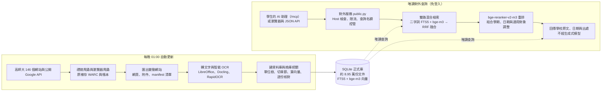

# 高師大校園資訊 MCP（nknu-facts）

把國立高雄師範大學（高師大）公開網站上的資訊整理好，透過 MCP 免登入開放給任何 AI 助理。學生用自己的 AI 問學校的事，就能拿到學校原文，每一筆都附來源網址、日期與出處。

MCP（Model Context Protocol）是 AI 助理呼叫外部工具的共通規格。接上之後，你問 Claude、ChatGPT、Cursor 或 Gemini「畢業門檻在哪裡看？」「宿舍什麼時候開放進住？」，它會來這裡搜尋學校的網頁、公告、附件與行事曆，讀原文再回答你。

- 這是學生維護的服務，**不是學校官方系統**。重要的事請以學校公告為準。
- 回答時**不呼叫會產生文字的生成式 AI 模型**。伺服器只用兩個打分模型（[bge-m3](https://huggingface.co/BAAI/bge-m3) 找相近的內容、[bge-reranker-v2-m3](https://huggingface.co/BAAI/bge-reranker-v2-m3) 排先後），回傳的是學校原文、程式的固定句子和程式算出的值，不會替學校編內容。
- 只能查詢，不能修改任何資料。
- 程式碼採 Apache-2.0 授權。

## 現在的狀態（2026-11-26）

- 收錄 146 個網站：107 個學校網站、5 個要用瀏覽器才看得到內容的網站、30 個學校單位放在校外的網站（Google 協作平台、Wix 等），以及 4 個只留存檔的舊網站。
- 約 8.95 萬份文件（網頁、附件與行事曆），每晚 01:00 自動更新，換庫前逐份核對。
- 服務在實驗室的電腦上執行，**還沒有對外網址**，目前外面連不到。有了網址會寫在這裡。

## 為什麼不直接讓 AI 上網搜？

一般搜尋引擎看得到學校的靜態網頁，但在大學網站上仍有幾塊結構性盲區：

- **表單與按鈕後的資料**：課程查詢與教學大綱、教師履歷分頁、ASP.NET 按鈕觸發下載的附件都沒有獨立網址，搜尋引擎爬不到。
- **複雜附件與掃描檔**：PDF 多欄表格、舊版 `.doc`／`.odt` 表單、公告裡的純圖片與掃描件，網搜常讀不完整或直接跳過。
- **混進別校與過時公告**：即使加上全名「國立高雄師範大學 NKNU」，網搜在站內抓不到正文時仍常混入外校校規，或拿到過期的舊公告。
- **實測結果**：以本地模型透過本服務回答 83 道學生日常問題，直接提問答對 81 題、部分對 1 題、錯 0 題（未見編造細節）；改寫成「幫我做事」的任務問法，答對 75 題、部分對 8 題、錯 0 題。

## 系統架構

系統分成「每晚自動更新」與「唯讀對外查詢」兩條獨立路徑，以同一份 SQLite 正式庫銜接：



## 兩個工具與對外介面

| 工具 | 做什麼 | 參數 |
|---|---|---|
| `search` | 搜尋高師大資料，回傳最相關的幾份文件和原文段落 | `query`：關鍵字或問句（繁體中文、台灣用語）<br>`detail`：每筆給多少原文，`passage`（預設，約 500 字）／`snippet`（約 200 字）／`full`（前 5 筆給全文或命中的章節與目錄）<br>`limit`：1～50，預設 10<br>`unit`：只看某個單位，全稱或簡稱都可以，填系所時也包含全校適用的文件；填了單位時，除 `results` 外還會附上 `other_units`（其他單位最相關的 3 筆），避免選錯單位而漏答<br>`sort`：`relevance`（預設，最相關的在前）／`date`（相關的結果裡由新到舊） |
| `fetch` | 讀一份文件 | `id`：`search` 回傳的 id，也可以填收錄的網頁或檔案網址<br>`part`：留空讀全文（太長給目錄和開頭）、填節號讀某一節、填 `toc` 只看目錄 |

兩個工具都免登入、唯讀。每次回傳控制在 50 KB 以內的精簡 JSON，包含資料覆蓋範圍、各網站截至日期（`data_as_of`）、文件身分、日期來源與原文；若查詢逾時或資料庫暫時不可讀，會明確說明這次失敗**不代表查無資料**。

同一個服務也有網頁和 JSON 介面，給沒有 MCP 的人和程式用：

| 路徑 | 是什麼 |
|---|---|
| `/mcp` | MCP（streamable HTTP，無狀態 JSON） |
| `/` | 說明頁，有搜尋框和各家 AI 的接法 |
| `/search?q=…` | 搜尋結果頁（可加 `unit=`、`sort=date`、`limit=`） |
| `/doc/<編號>` | 一份文件的頁面（長文件可加 `?part=節號`） |
| `/api/search`、`/api/fetch` | 和 MCP 一字不差的結果，回 JSON |
| `/llms.txt` | 給 AI 讀的說明 |
| `/health` | 服務還在不在、資料庫是什麼時候建的 |

## 接上你的 AI 助理

對外網址還沒公布。公布後，把下面的 `<對外網址>` 換成它（角括號一起換掉）。網址結尾是 `/mcp`。不需要登入、金鑰或本機橋接程式。

- **Claude 網頁版和桌面版**：Customize > Connectors，點「+ Add」，選「Add custom connector」，網址填 `<對外網址>/mcp`。
- **Claude Code**：

  ```bash
  claude mcp add --transport http --scope user nknu <對外網址>/mcp
  ```

- **Cursor**：在 `~/.cursor/mcp.json` 最外層的 `mcpServers` 加上：

  ```json
  { "mcpServers": { "nknu": { "url": "<對外網址>/mcp" } } }
  ```

- **OpenAI Codex CLI、ChatGPT 桌面版**（共用 `~/.codex/config.toml`）：

  ```bash
  codex mcp add nknu --url <對外網址>/mcp
  ```

- **Google Gemini CLI**：

  ```bash
  gemini mcp add --scope user --transport http nknu <對外網址>/mcp
  ```

## 資料怎麼來與工程做法

每晚 01:00 在實驗室的電腦上自動跑完四步：

1. **抓取**：各網站的首頁、公告列表、最近的公告和新附件；需要 JavaScript 的網站改由瀏覽器開啟；校外單位網站每週六複查，課表換學期自動重查。
2. **轉文字**：網頁和附件（PDF、Word、Excel、簡報、壓縮檔、圖片與掃描件）轉成文字，按檔案內容雜湊快取，未變動的檔案不重轉。
3. **建資料庫**：分出文件的標題、日期、發布單位、適用對象，依中文編號切章節與段落，算好向量。換上新資料庫之前，逐份核對舊庫有、新庫沒有的文件，說不出原因的過多就不換；單站異常時該站留在舊版，其餘照常更新。
4. **對外服務**直接讀取新的資料庫，不用重新啟動。

### 針對校園公文做的整理

- **原樣存檔（WARC）**：所有抓回來的網頁與檔案都以標準 WARC 保留。日後修改解析或切段規則，只需在本機重跑匯出與建庫，不必重複打擾學校伺服器。
- **分流轉文字與 OCR**：舊版 Office／ODT 先經 LibreOffice 轉新格式；電子字 PDF 與表格交由 Docling 保留表格結構（回傳段落若切進表格中間會自動補表頭）；純掃描頁與文字層亂碼頁自動分流給 RapidOCR（繁體模型）。組裝時同步處理康熙部首／相容漢字歸一、常見字型錯碼修正與公文空格斷字還原。
- **附件認親與多格式合一**：區分網頁正文區、附件區與側邊欄選單，避免側邊欄常駐檔案被誤掛到個別公告底下。檔名或按鈕只寫「下載」「PDF」時，自動從所在表格列或列表項抓回真名；同一份表單的 `.doc`／`.odt`／`.pdf` 合併成一筆主文件（其餘格式列在副本欄），不重複佔據搜尋名額。
- **誠實的日期與單位樹**：優先讀網頁固定日期欄，附件繼承所屬公告日期（沒有才退回伺服器檔案時間），每筆都標明日期來源；依「全校 → 學院／處室 → 系所／組別」的單位樹建立適用與發布關係。

抓取的規矩：每台伺服器同時只連一條線，每次回應後等 1～2 秒，遵守 `robots.txt`，不繞過登入或任何保護。抓取失敗或網站改版時保留上一次好的資料，不拿壞的蓋掉好的。

沒有收的：要登入的網頁（選課、成績、校務行政、數位學習平台）、學校網站連出去的校外網站（只記網址）、老師著作的論文全文、給中小學老師的教材下載區、超過上限的活動照片。

## 隱私與限流

- 不需要登入，不記 IP，也不記是誰在查。
- 查詢的內容會記下來用來改進搜尋；查詢裡像電話、學號、信箱的字會先遮掉。
- 每個用戶每分鐘最多 60 次查詢，伺服器同時最多處理 4 個查詢（其餘排隊，逾時回傳忙碌提示）。

## 程式在哪

| 資料夾 | 內容 |
|---|---|
| `src/nknu/archive/` | 爬蟲：發請求、原樣存檔（WARC）、全機共用請求鎖、每晚更新、維護頁警報、匯出 |
| `src/nknu/totext/` | 網頁和附件轉文字與智能 OCR |
| `src/nknu/content/` | 建資料庫：連結與附件認親、日期、單位樹、章節與段落、向量、換庫把關 |
| `src/nknu/retrieval/` | 雙路混合檢索、重排、MCP、網頁和 JSON 介面（`public.py` 是對外服務） |
| `src/nknu/ops/` | 維護用的檢視台（總覽、每晚運行、網站、單位、搜尋測試、文件追蹤、網頁核查） |
| `src/nknu/core/` | 共用模組（文字正規化、個資遮蔽、模型服務等） |
| `src/nknu/admin/` | `nknu` 指令入口（爬蟲操作、推送前檢查 `nknu check`） |
| `config/` | 單位表、別名、網站和單位的對應、抓取設定 |
| `deploy/` | 實驗室電腦上的容器配置、安裝與每晚排程，各資料夾的 `README.md` 是維護說明（簡體中文） |
| `tests/` | 測試（6,300+ 項自動化測試） |

第一版（只有場館開放時間、教學行事曆和公告的 4 個工具）的程式已經從這個分支拿掉，要看可以到 `feat/v1` 分支。

## 自己架一份

環境需求：Python 3.13（`>=3.13,<3.14`）與 [uv](https://docs.astral.sh/uv/)。

資料庫不在 git 裡：它很大，而且是從學校網站抓下來的。要自己架，得先跑抓取和建資料庫（見 `deploy/lab-crawler/` 和 `deploy/lab-pipeline/`）。有了資料庫以後：

```bash
# 安裝含檢索與轉文字模型套件的完整環境（若要跑瀏覽器爬蟲，另加 --extra browser）
uv sync --extra pipeline

# 啟動對外服務（MCP、網頁與 JSON 介面）
uv run python -m nknu.retrieval.public --db <資料庫路徑> --port 8770
```

第一次執行會從 Hugging Face 下載兩個打分模型（合計幾 GB）。若只想在本機測試關鍵字檢索、不下載模型，可加上 `--no-dense --no-rerank`。服務預設只監聽本機 `127.0.0.1`。

跑測試與提交前檢查（授權與個資掃描）：

```bash
uv run pytest
uv run nknu check
```
